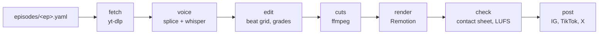

<div align="center">


# reels

**One real voice. One song. The turning word lands on the drop.**

A spec-driven studio for 9:16 story reels (Instagram Reels, TikTok, YouTube Shorts, X),
built on [Remotion](https://www.remotion.dev). You write one YAML file, it fetches the footage, splices the voice,
times every cut to the song's beat grid and renders a 1080x1920 reel with word-by-word captions.

[Instagram: @hey_synapse](https://instagram.com/hey_synapse) · [The recipe](RECIPE.md) · [Spec format](#the-spec)

</div>

---

## What a reel is

Every reel tells one true story in about 35 seconds, in the voice of the person it happened to.

```
 hook         build-up             turn            riser       DROP            payoff        end card
 0 s ─────── cold, slow ───────── warm ────── cuts tighten ── ★ ──── vivid, on the beat ──── 2.8 s
 "brian chesky's terrible idea                                "$40"
  was saved by cereal"
```

- **The voice** is cut from a real interview and re-spliced so the climax word hits the song's drop exactly.
- **The cuts** sit on a beat grid (`b-4`, `b0`, `b2` mean beats from the drop), so the edit breathes with the music.
- **The grade** follows the story: cold and bleak in the build, amber at the turn, vivid after the drop.
- **The captions** come from whisper word timings, corrected by hand, shown word by word in glass caps.
- **The end card** collapses the footage into a node and animates the mark above. Turn it off per theme.

## How it works



| Stage | Command | Writes |
|---|---|---|
| fetch | `reel.py build <theme>/<ep> --only fetch` | `public/<theme>/<ep>/raw/` |
| voice | `--only voice` | `vo.wav`, `words.json` |
| edit | `--only edit` | `edit.json` (shots, grades, music, headline) |
| cuts | `--only cuts` | `cuts/*.mp4`, graded and cropped |
| render | `npm run render -- <Id>` | `out/<Id>.mp4` |
| check | `reel.py check <Id>` | contact sheet, hook and drop frames, loudness |

## Quick start

You need Node 20+, Python 3.10+, `ffmpeg`, `yt-dlp` and [whisper.cpp](https://github.com/ggml-org/whisper.cpp) (`whisper-cli`).

```bash
brew install ffmpeg yt-dlp whisper-cpp            # or your platform's equivalent
git clone https://github.com/VishiATChoudhary/reels && cd reels
npm install
pip install -r requirements.txt
curl -L -o tools/models/ggml-base.en.bin --create-dirs \
  https://huggingface.co/ggerganov/whisper.cpp/resolve/main/ggml-base.en.bin
```

Or let your agent do it. Install the [`reels-setup`](skills/reels-setup/SKILL.md) skill, then ask it to set up the studio:

```bash
npx skills add VishiATChoudhary/reels
# or
curl -fsSL https://raw.githubusercontent.com/VishiATChoudhary/reels/main/install.sh | bash
```

`bash tools/setup.sh` does the same install + verify by hand.

Then make your own:

1. **Pick a theme**, or copy `themes/tech.json` to a new one and add it in `src/Root.tsx`. Set your `handle`.
2. **Add songs.** Put mp3s in `public/shared/music/`, then measure them:
   `python3 tools/measure_song.py public/shared/music/your-song.mp3` and add `bpm` and `drop` to `themes/songs.json`.
3. **Scaffold an episode:** `python3 tools/reel.py new tech p01-my-story`
4. **Fill the spec** (below), then build: `python3 tools/reel.py build tech/p01-my-story`
5. **Preview** with `npm run studio`, **render** with `npm run render -- Tech-P01-My-Story`,
   **check** with `python3 tools/reel.py check Tech-P01-My-Story`.

The repo ships specs, transcripts and edit files for 15 reels, but no media: footage and music are
third-party and git-ignored. Rebuilding one of them runs `fetch` again from the URLs in its spec.

## The spec

One file per reel. Times are in seconds, `b<n>` is beats from the drop, `s<n>` is the start of voice segment `n`.

```yaml
song: strike-me-down
headline: brian chesky's terrible idea was saved by *cereal*
end: b14

sources:
  speaker: {url: "https://www.youtube.com/watch?v=..."}   # the interview
  circuit: {url: "https://www.youtube.com/watch?v=..."}   # b-roll

voice:
  src: speaker
  climax: {seg: 7, word: "40"}          # this word lands on the drop
  segments:
    - [8.33, 11.95, 0.25]               # [from, to, pause after]
    - [124.22, 131.60, 0.35]
  fix: [["going", "gluing"]]            # whisper mishearings

shots:
  - 0       hook     speaker@sync    WARM   crop=300:300:1420:140
  - s1      glue     glue@19.2       TEAL   zoom=1.3 origin=60%,85%
  - b-2     pour     pour@1.0        AMBER
  - b0      forty    circuit@66.0    VIVID  flash
```

[`RECIPE.md`](RECIPE.md) is the full craft guide: picking the story before downloading anything, choosing the song,
splicing the voice, pacing the cuts, writing the headline, and the mistakes already made.

## Themes

A theme is a JSON file in `themes/` plus a folder with its story bank and style notes.

```jsonc
{
  "id": "tech",
  "prefix": "Tech",
  "handle": "@your_handle",
  "outro": true,                 // false: no end card, the reel ends on the last shot
  "frame": "card",               // card (square, centred) or wide
  "music": { "volume": 0.32, "pool": ["wild", "before"] },
  "arc": { "build": ["COLD", "BLEAK"], "turn": ["AMBER"], "payoff": ["VIVID", "RED"] }
}
```

Shipped themes: `tech` (15 episodes), `sports` and `history` (scaffolded). Grades live in `themes/grades.json`.

## Posting

`npm run post -- <Id>` posts `out/<Id>.mp4` with the caption in `posts/<Id>.txt` through the official APIs of
X, Instagram and TikTok. `npm run social -- setup` lists which credentials are missing and where to get them.
Credentials are read from environment variables, the `vault` CLI if you have one, or `~/.reels/keys.json`.

```bash
npm run post -- Tech-P15-Airbnb --only instagram --dry
npm run social -- metrics
```

## Layout

```
themes/            theme configs, song library, ffmpeg grades
<theme>/           THEME.md (voices, story shape, story bank) and episodes/*.yaml
src/shared/        Edit.tsx (renderer), Outro.tsx (end card), style.ts
tools/reel.py      new | build | words | check
tools/social/      posting and metrics
public/<theme>/    per-episode edit.json, words.json, srcmap.json (media git-ignored)
posts/             captions
tech/sources/      legacy shell builds for the first episodes, kept for reference
```

## On footage and music

All footage, voices and music used by these reels belong to their owners. This repo contains no media, only code,
specs and transcripts. If you make reels with it, the rights question is yours: platforms may mute or remove
copyrighted audio, and fair use depends on how much you use and how you transform it.

## License

Code is [MIT](LICENSE). The end-card mark is the Synapse logo; swap it for your own in `src/shared/Outro.tsx`,
or set `"outro": false`.
